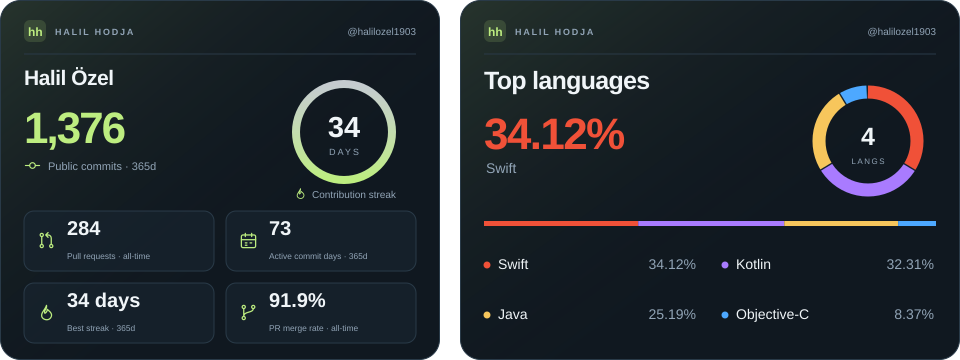

<div align="center">
  
  <h1>Halil Hodja</h1>
  <p><strong>GitHub hikâyen, güzel bir anlatımla.</strong></p>
  <p>Şık profil kartları. Şeffaf veriler. Herkes için açık kaynak.</p>
  <a href="https://halil-hodja.halilozel1903.chatgpt.site/?locale=tr">Kart stüdyosunu aç</a> · <a href="README.md">English / tam API rehberi</a>
</div>



## Neler yapar?

- GitHub istatistiklerini ve dil dağılımını kişiselleştirilebilir SVG kartlarına dönüştürür.
- Midnight, Paper, Aurora, Ocean, Rose ve Terminal temalarını sunar.
- Kart çifti, istatistik, dil ve birleşik kart düzenleri içerir.
- Markdown, HTML ve görsel bağlantısı üretir; SVG indirmeni sağlar.
- Fork/arşiv filtresi, repo hariç tutma ve 2–8 dil gösterme seçenekleri vardır.
- Türkçe ve İngilizce çalışır. MIT lisanslıdır; kendi sunucunda yayımlayabilirsin.

## Veriler gerçek mi?

**Evet. Başarılı canlı kartların tamamı doğrudan GitHub API’den gelen verilerle hesaplanır.** Sahte sayı, rastgele aktivite veya uydurma katkı puanı yoktur. GitHub hata verirse hata gösterilir; veri yerine sıfır yazılmaz. Repodaki önizleme SVG’leri tarihli anlık görüntülerdir.

- **Repo:** filtrelere uyan ve kullanıcıya ait herkese açık repoların sayısı.
- **Yıldız ve fork:** bu repolardaki sayıların toplamı.
- **Takipçi:** GitHub profilindeki genel takipçi sayısı.
- **Repo sayısına göre diller:** ana dili belli olan her repo bir kez sayılır. Kod satırı ya da kod boyutu ölçümü değildir.
- **Kod boyutuna göre diller:** en son kod gönderilen, boş olmayan en fazla 20 uygun reponun gerçek dil baytları toplanır. Tüm hesabın kod boyutu gibi sunulmaz; örneklem sayısı belirtilir.

Varsayılan olarak fork ve arşivlenmiş repolar hariçtir. Özel repolar, commit sayısı, katkı serisi ve kullanıcının sahibi olmadığı organizasyon repoları dahil değildir. İlk 1.000 repo taranır; sınır aşıldıysa sonuç kısmi olarak işaretlenir. Görünmeyen dillerin oranı “Diğer” olarak kalır; gösterilen yüzdeler şişirilmez.

Veriler bir saate kadar önbellekte tutulur. JSON yanıtındaki `updatedAt` ve `scope` alanları zamanı/kapsamı gösterir. GitHub’ın görsel önbelleği ayrıca gecikme ekleyebilir. API taraması tek bir atomik anlık görüntü değildir; tarama sırasında GitHub sayıları değişebilir.

Bağımsız kontrol için GitHub CLI ile giriş yapıp çalıştır:

```sh
npm run verify:live -- halilozel1903 https://halil-hodja.halilozel1903.chatgpt.site
```

Bu kontrol repo, yıldız, fork, takipçi, dil adetleri, yüzdeler ve tarama kapsamını ayrı GitHub sorgularıyla karşılaştırır. Güncel GitHub verisi saatlik önbellekten farklıysa iki sonucu gösterip başarısız çıkar. İlk karşılaştırma: [doğruluk raporu](docs/ACCURACY.md).

## README’ye ekle

```html
<div align="center">
  
  
</div>
```

Kendi kullanıcı adını yaz. Stüdyodan istediğin temayı seçerek aynı kodu otomatik üretebilirsin.

## Kurulum

Node.js 22.13+ ve npm gerekir.

```sh
git clone https://github.com/halilozel1903/halil-hodja.git
cd halil-hodja
npm run install:ci
npm run dev
# http://127.0.0.1:5173
```

```sh
npm test
npm run typecheck
npm run build
npm start
```

## Kendi hesabında yayımla

Cloudflare Workers ve statik dosyalar kullanılır. Veritabanı veya ChatGPT Sites hesabı gerekmez.

```sh
npm run build
node node_modules/wrangler/bin/wrangler.js login
npm run deploy:cloudflare
```

Başka Worker adı için `WORKER_NAME=benim-kartlarim npm run deploy:cloudflare` kullan. Yayımlamadan kontrol etmek için `npm run deploy:cloudflare -- --dry-run` çalıştır.

Yoğun kullanımda sunucu tarafında, yalnızca herkese açık veriler için yetkili özel bir GitHub token’ı tanımlayabilirsin:

```sh
node node_modules/wrangler/bin/wrangler.js secret put GITHUB_TOKEN --name halil-hodja
```

Yerel geliştirmede git tarafından yok sayılan `.dev.vars` dosyasına `GITHUB_TOKEN=...` yazılır. Token’ı URL’ye, tarayıcı koduna veya `NEXT_PUBLIC_` değişkenine koyma. Token olmadan GitHub’ın IP başına saatlik ortak kotası geçerlidir. Canlı demo hafif kullanım içindir; kesintisiz hizmet garantisi yoktur.

`.openai/hosting.json` resmi Sites yayınının herkese açık kimliğidir; bir parola değildir. Standart Cloudflare yayını bu kimliği kullanmaz. Sites üzerinden kendi kopyanı yayımlayacaksan kendi Site kimliğinle değiştir.

## API

`/api/card?username=AD&type=stats|languages|overview` SVG; `/api/profile?username=AD` JSON döndürür. `/api?username=AD` ve `/api/top-langs/?username=AD` kısa bağlantıları da vardır.

Parametreler: `theme`, `locale=en|tr`, `langs_count=2..8`, `metric=repos|bytes`, `forks=true|false`, `archived=true|false`, `exclude=repo-bir,repo-iki`.

Diğer araçlardaki `count_private`, `hide` veya `show_icons` gibi parametreler uygulanmaz. Tam davranışlar ve hata kodları [İngilizce API tablosunda](README.md#api).

## Katkı ve gizlilik

[Katkı rehberine](CONTRIBUTING.md) göz at. Uygulama analitik/takip betiği, kullanıcı hesabı veya veritabanı eklemez. GitHub ve barındırma servisi açık kullanıcı adlarını işler; normal erişim kayıtları tutabilir. Stüdyo Google Fonts kullanır; SVG kartlar dış font çağrısı yapmaz. [Güvenlik politikası](SECURITY.md) · [MIT lisansı](LICENSE).

[Halil Özel](https://github.com/halilozel1903) tarafından, bir şeyler üreten herkes için.
